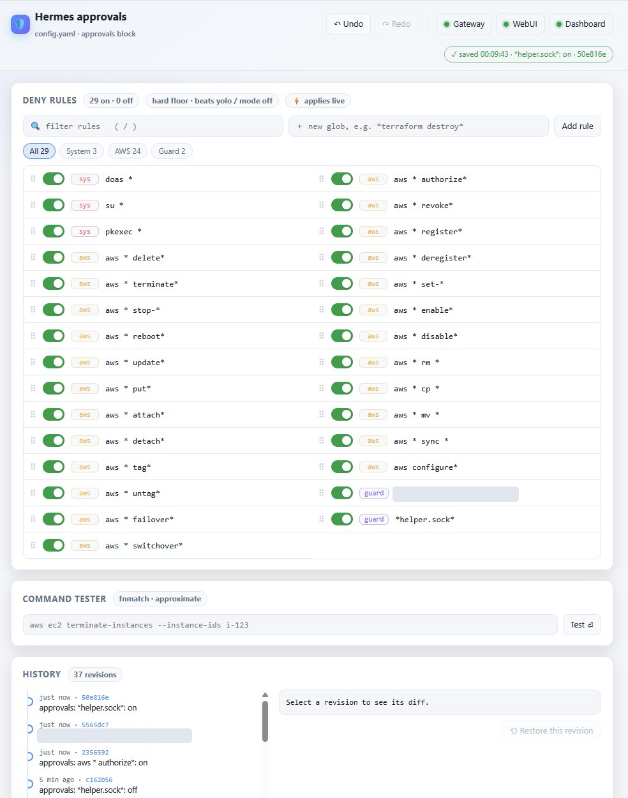

# hermes-config-ui

Web UI to edit the `approvals:` block of the Hermes `config.yaml` on a Hermes host.



- Save on edit (800 ms debounce). Each save is one atomic write and one git commit in a
  private history repository (`~/.local/share/hermes-config-ui/history`).
- Undo, redo and restore write an old revision again as a new commit. History is never rewritten.
- A disabled deny rule is a comment line `  #  - <glob>`. Only the lines of the
  `approvals:` block change. All other bytes of the file stay the same.
- A save is refused (HTTP 409) if the block changed on disk after the page loaded.
- The host helper (`helper/`) restarts only the gateway, the WebUI and the dashboard
  units, and sends a Telegram message on each save and restart.


## Requirements

- Docker with Compose v2.
- [nginx-proxy](https://github.com/nginx-proxy/nginx-proxy) on the external Docker
  network `proxy-net`. It routes `VIRTUAL_HOST` to the container.
- Hermes runs as systemd user units on the same host.
- Telegram notify (optional) reads `TELEGRAM_BOT_TOKEN` and `TELEGRAM_HOME_CHANNEL`
  from the Hermes `.env` file. The helper never logs or returns the token.

## Deploy

1. Clone the repository to `<repo-dir>`. The unit file expects
   `~/repo/tools/hermes-config-ui`. If you use a different path, edit `ExecStart`.
2. Install the helper:

   ```bash
   ln -sf <repo-dir>/helper/hermes-config-ui-helper.service ~/.config/systemd/user/
   systemctl --user daemon-reload && systemctl --user enable --now hermes-config-ui-helper
   ```

3. Copy `.env.example` to `.env`. Set `HCUI_HOST`.
4. Start the container: `docker compose up -d --build`.
5. Configure nginx-proxy to give basic auth and an IP allow-list for `HCUI_HOST`.
   The app refuses `/api/` requests that have no `Authorization: Basic` header.

## Settings

| Variable | Read by | Default | Purpose |
| --- | --- | --- | --- |
| `HCUI_HOST` | compose | none (required) | Public host name (`VIRTUAL_HOST`) |
| `HCUI_HERMES_DATA` | compose | `$HOME/hermes/data` | Hermes data folder with `config.yaml` |
| `HCUI_HISTORY` | compose | `$HOME/.local/share/hermes-config-ui/history` | Private git history of saves |
| `HCUI_RUN` | compose | `$HOME/.local/share/hermes-config-ui/run` | Folder of the helper socket |
| `HCUI_REQUIRE_AUTH` | app | `1` | `0` turns off the `Authorization` header check |
| `HCUI_HELPER_SOCK` | app, helper | `/run/hcui/helper.sock` (app), `$HOME/.local/share/hermes-config-ui/run/helper.sock` (helper) | Helper Unix socket |
| `HCUI_HERMES_ENV` | helper | `$HOME/hermes/data/.env` | File with the Telegram settings |
| `HCUI_UNIT_GATEWAY` | helper | `hermes-gateway.service` | Gateway unit name |
| `HCUI_UNIT_WEBUI` | helper | `hermes-webui.service` | WebUI unit name |
| `HCUI_UNIT_DASHBOARD` | helper | `hermes-dashboard.service` | Dashboard unit name |

Put helper settings in `~/.config/hermes-config-ui/helper.env`. The unit file loads
this file if it exists.

## Test

```bash
docker run --rm -v $PWD:/src:ro -w /src hermes-config-ui python tests/test_block.py <copy-of-config.yaml>
```

## License

MIT. See `LICENSE`.
